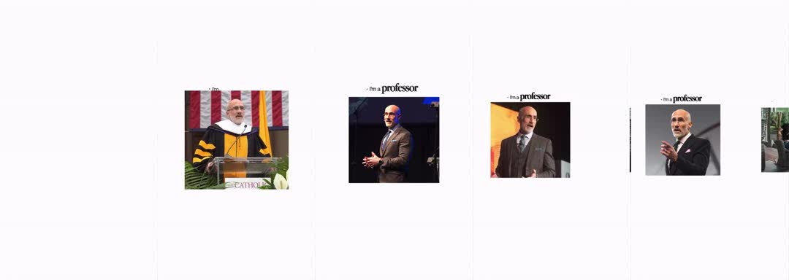

# v01_s06 · 03 Imágenes - personajes + texto · 5.9–7.2s (calidad 4)

- **Guion:** a professor, I'm
- **Qué se ve:** Papel blanco con una sola foto centrada: Arthur con traje de cuadros sobre fondo lila, señalando. Etiqueta '- I'm a professor'.
- **Diseño:** Foto ~45 % del ancho, centrada a ~55 % del alto; etiqueta encima: 'I'm a' sans diminuta + 'professor' serif bold negra pequeña. Fondo blanco.
- **Efectos:** Foto con borde blanco fino y sombra suave.
- **Animación:** La foto aparece con pop+fade y escala suave (≈0.3 s); el texto write-on a la vez.
- **Por qué aquí:** Primer rol, aislado y grande para que pese.
