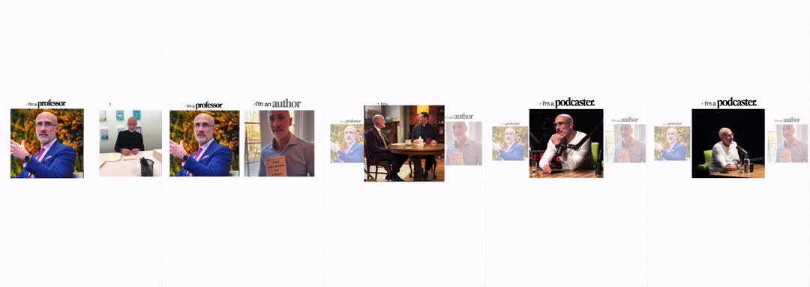

# v01_s07 · 03 Imágenes - personajes + texto · 7.2–9.6s (calidad 4)

- **Guion:** an author, I'm a podcaster.
- **Qué se ve:** La foto de 'professor' se encoge a la izquierda-arriba y entra a la derecha otra foto (él sosteniendo un libro): 'I'm an author'. Composición diagonal.
- **Diseño:** Dos fotos pequeñas (~30 % del ancho) en diagonal: izquierda más alta, derecha más baja; etiquetas sans diminuta + rol en serif bold. Mucho blanco alrededor.
- **Efectos:** Sombras suaves de papel; sin textura.
- **Animación:** Transición tipo 'camera pull-out': la primera foto se reduce y desplaza (≈0.4 s, ease-out), la segunda entra con pop. Sensación suave y ordenada.
- **Por qué aquí:** Acumula roles; la diagonal crea contraste y dinamismo sin saturar.
