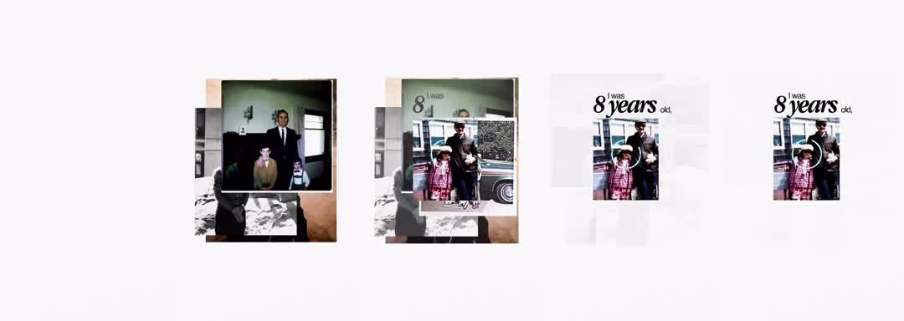

# v01_s14 · 03 Imágenes - personajes + texto · 22.9–24.0s (calidad 4)

- **Guion:** I was eight years old,
- **Qué se ve:** Papel blanco: fotos familiares antiguas apiladas (niño con padre junto a un coche, foto de casa) que caen una sobre otra; texto '8 / I was'.
- **Diseño:** Fotos con borde blanco, ~60 % del ancho, ligeramente rotadas (±3–5°), centradas a ~55 % alto; número '8' grande en serif.
- **Efectos:** Sombras de papel, colores de foto vintage desvaídos.
- **Animación:** Frame blanco vacío (≈0.1 s) y luego las fotos caen con rotación leve y rebote suave (≈0.3 s cada una).
- **Por qué aquí:** Inicio del flashback: el papel blanco señala 'archivo personal / pasado'.
