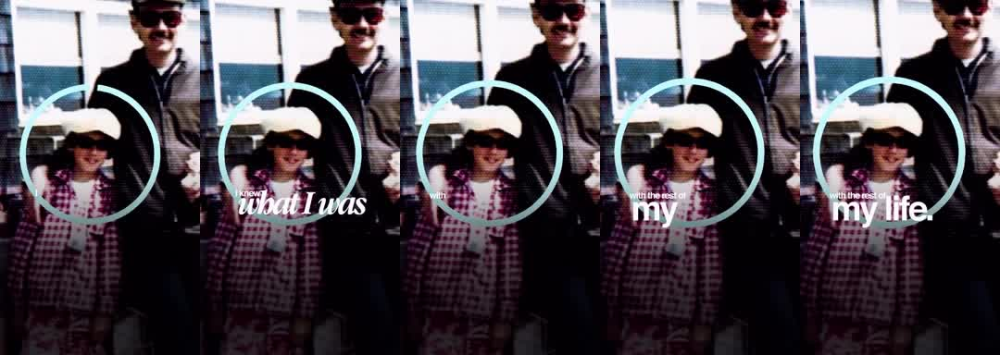

# v01_s15 · 03 Imágenes - personajes + texto · 24.0–26.0s (calidad 5)

- **Guion:** I knew what I was going to do with the rest
- **Qué se ve:** Foto de archivo a pantalla completa: niño con gorro blanco y camisa a cuadros junto a su padre; un aro cian brillante rodea la cara del niño. Caption 'I knew / what I was / going to'.
- **Diseño:** Aro circular trazo fino cian claro ~#BFEFF5, ~45 % del ancho, sobre el niño (tercio inferior-izquierdo). 'what I was' serif itálica bold blanca grande; contexto sans pequeña.
- **Efectos:** Scanlines CRT horizontales sobre la foto, glow alrededor del aro, ligera aberración/grano de video antiguo.
- **Animación:** Push-in lento a la foto (≈2 s); el aro se dibuja/aparece con glow (≈0.3 s).
- **Por qué aquí:** Señala al protagonista dentro de la foto del pasado: el espectador lo identifica sin explicación.
