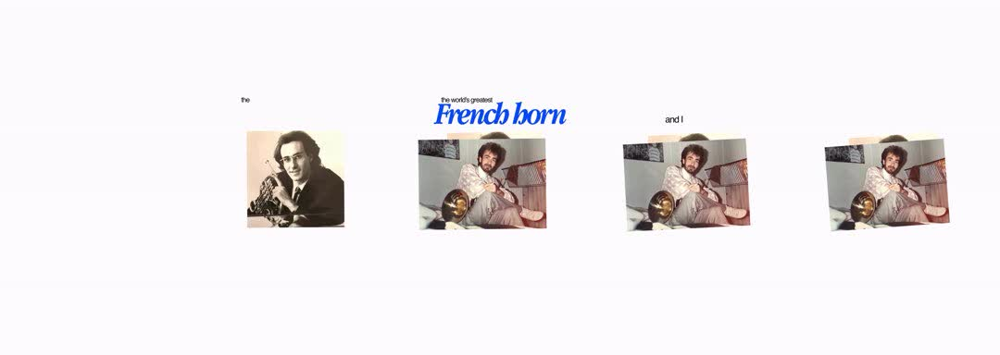

# v01_s17 · 03 Imágenes - personajes + texto · 26.7–30.4s (calidad 5)

- **Guion:** (the world's greatest French horn player) of the
- **Qué se ve:** Papel blanco: 'the world's greatest / French horn' y foto B/N de joven con corno francés; luego otra foto a color girada (joven sentado con el corno).
- **Diseño:** 'French horn' serif itálica bold azul ~#2E4FD8 grande (~7 % alto) sobre la foto; 'the world's greatest' sans diminuta negra encima-izquierda. Foto ~50 % ancho centrada a ~55 % alto.
- **Efectos:** Foto B/N sepia con grano; la segunda a color vintage cálido. Sombras de papel.
- **Animación:** La foto B/N aparece con pop; luego se reemplaza por la foto a color que entra rotando (≈-6°) y se asienta (≈0.4 s, ease-out).
- **Por qué aquí:** Muestra el sueño de infancia (música) con prueba fotográfica; azul = dato clave.
