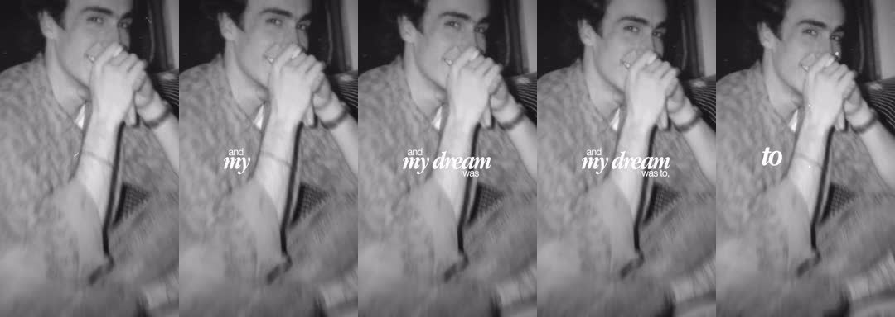

# v01_s19 · 03 Imágenes - personajes + texto · 32.4–34.1s (calidad 4)

- **Guion:** and my dream was to go
- **Qué se ve:** Foto B/N a pantalla completa: joven Arthur con manos juntas en la boca, pensativo. Caption 'and / my dream / was to,'.
- **Diseño:** 'my dream' serif itálica bold blanca grande al centro (~52 % alto); 'and' y 'was to,' sans pequeña arriba-izquierda / abajo-derecha.
- **Efectos:** B/N con grano y suavidad (desenfoque ligero), contraste bajo.
- **Animación:** Push-in lento (≈1.7 s); caption pop + blur reveal.
- **Por qué aquí:** Momento emocional (el sueño): foto íntima en B/N en lugar de cara actual.
