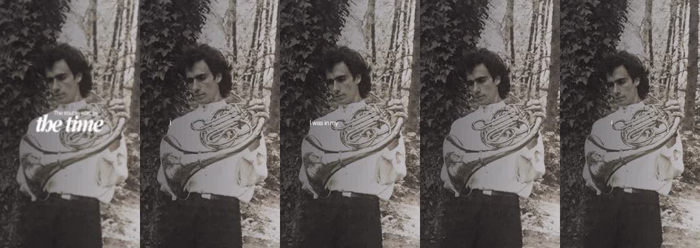

# v01_s23 · 03 Imágenes - personajes + texto · 39.0–41.5s (calidad 4)

- **Guion:** by the time I was in my mid-20s, I was
- **Qué se ve:** Foto B/N vintage: joven con pelo largo sosteniendo el corno francés entre hiedra. Caption pequeño 'I was in my'.
- **Diseño:** Foto a pantalla completa; caption sans pequeña blanca centrada a ~50 %.
- **Efectos:** B/N sepia, grano, viñeta suave.
- **Animación:** Push-in muy lento (Ken Burns, ≈2.5 s).
- **Por qué aquí:** Ilustra la etapa de músico joven mientras narra la crisis.
