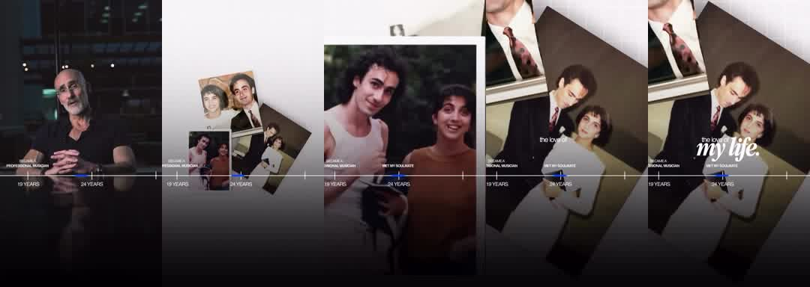

# v01_s28 · 03 Imágenes - personajes + texto · 52.3–56.1s (calidad 5)

- **Guion:** old, as a matter of fact, because I met my soulmate, the love of my life.
- **Qué se ve:** Sobre la timeline (hito 'MET MY SOULMATE · 24 YEARS') caen fotos de pareja de los 80 (él y su esposa), una encima de otra, cubriendo la pantalla; caption 'the love of / my'.
- **Diseño:** Fotos grandes (60–90 % ancho) con borde blanco, rotadas ±8–15°; fondo pasa de A-roll a blanco; 'my' serif itálica bold blanca.
- **Efectos:** Sombras fuertes de papel, colores vintage cálidos, ligero motion blur en la caída.
- **Animación:** Fotos caen desde fuera de cuadro con rotación y se asientan (≈0.3 s cada una, ease-out con leve rebote); cámara se acerca progresivamente.
- **Por qué aquí:** Hito emocional (el amor): acumulación de recuerdos que 'inundan' la pantalla.
