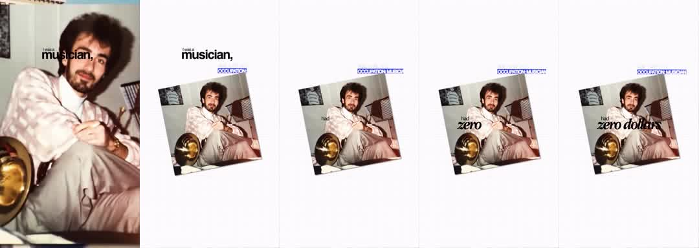

# v01_s33 · 03 Imágenes - personajes + texto · 61.9–63.1s (calidad 5)

- **Guion:** musician, had zero
- **Qué se ve:** La misma foto se reduce a tarjeta girada sobre papel blanco con 'I was a / musician,' y etiqueta tipo ficha 'OCCUPATION: MUSIC'.
- **Diseño:** 'musician,' bold sans negra grande en el tercio superior (~25 % alto); etiqueta rectangular azul ~#2E4FD8 con texto blanco en versalitas pequeñas ('OCCUPATION') pegada a la esquina de la foto. Foto ~55 % ancho rotada ~-10°, centrada a ~55 %.
- **Efectos:** Sombra de papel; foto con borde blanco.
- **Animación:** Transición pantalla completa → tarjeta: la foto se encoge y rota (≈0.4 s, ease-out); la etiqueta aparece con pop/typing.
- **Por qué aquí:** Dato tipo 'ficha de expediente': convierte un rol en dato objetivo.
