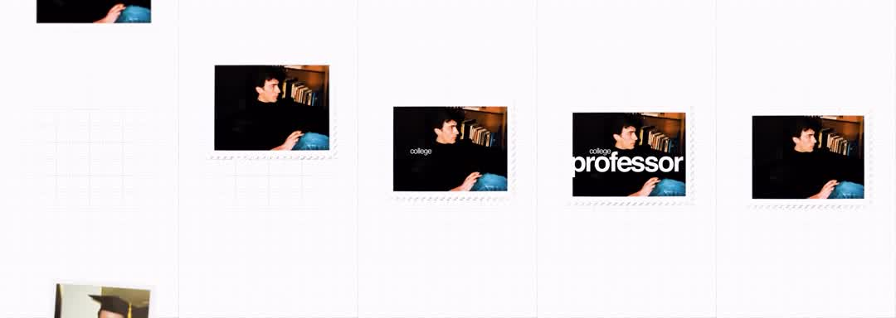

# v01_s36 · 03 Imágenes - personajes + texto · 70.6–72.7s (calidad 4)

- **Guion:** then to become a college professor.
- **Qué se ve:** Papel blanco con foto con borde de sello postal dentado (él joven en estudio con estantería); 'college / professor' sobre la foto.
- **Diseño:** 'professor' bold sans blanca grande sobre la foto (~50 % alto); 'college' sans pequeña encima. Foto ~65 % ancho con borde dentado tipo sello.
- **Efectos:** Borde de sello (perforado), sombra suave, retícula tenue.
- **Animación:** La foto entra desde arriba y baja al centro (≈0.4 s); caption pop.
- **Por qué aquí:** Cierra la etapa: el sello sugiere 'documento oficial' del logro.
