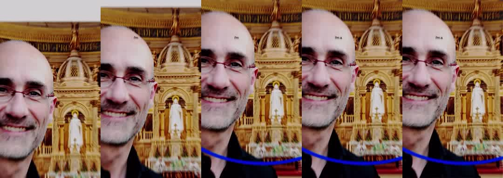

# v01_s51 · 03 Imágenes - personajes + texto · 108.6–109.3s (calidad 4)

- **Guion:** I'm a
- **Qué se ve:** Selfie en primerísimo plano de Arthur sonriendo dentro de una catedral barroca dorada; aparece el borde de un óvalo azul.
- **Diseño:** Foto a pantalla completa; caption pequeño 'I'm / I'm a' sans blanca en el tercio superior; trazo azul ~#2B4BE0 entrando por abajo.
- **Efectos:** Colores dorados saturados de la iglesia.
- **Animación:** Zoom-out rápido (la foto se aleja) mientras el óvalo empieza a dibujarse (≈0.7 s).
- **Por qué aquí:** Prepara la revelación con la foto más personal (selfie).
