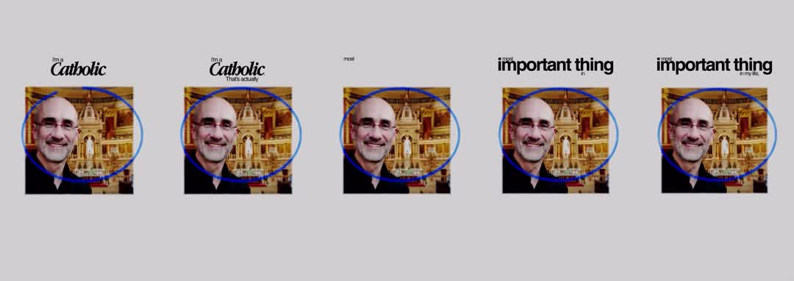

# v01_s52 · 03 Imágenes - personajes + texto · 109.3–111.6s (calidad 5)

- **Guion:** That's actually the most important thing in my life
- **Qué se ve:** Papel gris claro: la selfie reducida a tarjeta con un óvalo azul dibujado a mano rodeando su cara. Texto 'I'm a / Catholic / That's actually the'.
- **Diseño:** Fondo gris claro ~#DADADF; foto ~70 % ancho centrada a ~58 %; 'Catholic' serif itálica bold negra (~6 % alto) encima en el tercio superior; óvalo trazo azul ~#2B4BE0 grosor medio, irregular tipo rotulador.
- **Efectos:** Trazo a mano (marker) imperfecto; sombra suave de la foto.
- **Animación:** Zoom-out desde pantalla completa a tarjeta (≈0.5 s, ease-out); óvalo se dibuja (stroke-draw ≈0.4 s).
- **Por qué aquí:** Revelación de identidad: el gesto 'marcado a mano' lo subraya como lo más importante.
