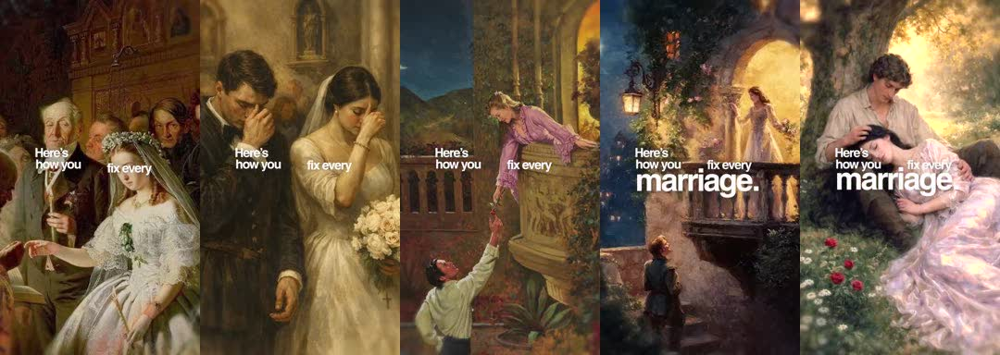

# v06_s02 · 03 Imágenes - personajes + texto · 0.5–1.2s (calidad 5)

- **Guion:** fix every marriage,
- **Qué se ve:** Ráfaga de 4 pinturas clásicas/románticas de parejas (boda decimonónica, novio llorando junto a novia, galán al pie de un balcón, pareja abrazada bajo un árbol) de ~0.15–0.3 s cada una.
- **Diseño:** 'Here's how you' y 'fix every' en sans bold pequeña blanca a izquierda y derecha; 'marriage.' sans bold blanca grande debajo, centrada en el tercio medio-superior. El bloque de texto se mantiene idéntico a través de los cortes.
- **Efectos:** Óleo con barniz cálido, sombras de pintura; sin texturas añadidas.
- **Animación:** Cortes secos rítmicos cada 3–8 frames con el texto fijo; 'marriage.' pop al final.
- **Por qué aquí:** Hook visual: el tema 'matrimonio' se vuelve universal y emocional con pinturas; el montaje rápido sube la energía en el primer segundo.
