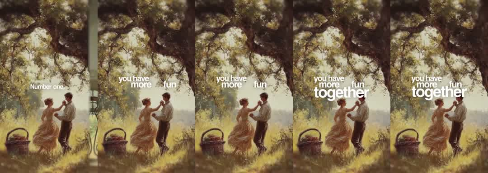

# v06_s04 · 03 Imágenes - personajes + texto · 2.6–4.0s (calidad 4)

- **Guion:** Number one, you have more fun together
- **Qué se ve:** Pintura de una pareja bailando bajo un gran roble con cesta de picnic; resto de la franja '4.' visible al borde derecho al inicio.
- **Diseño:** 'Number one,' sans bold pequeña; luego 'you have / more / fun / together' con 'together' sans bold grande. Centrado en el tercio medio-superior sobre el follaje.
- **Efectos:** Óleo luminoso, tonos verdes y dorados.
- **Animación:** Wipe desde el split; write-on por palabra con escalonado (palabras en distintas alturas que se apilan).
- **Por qué aquí:** Primer punto de la lista ilustrado con alegría literal (bailar).
