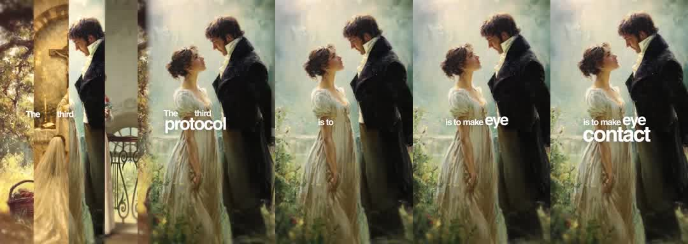

# v06_s17 · 03 Imágenes - personajes + texto · 21.9–24.8s (calidad 5)

- **Guion:** The third protocol is to make eye contact
- **Qué se ve:** Pintura romántica estilo Regencia: dama de blanco y caballero de levita mirándose fijamente en un jardín luminoso.
- **Diseño:** 'The third' sans bold pequeña, 'protocol' sans bold grande; luego 'is to make' pequeña + 'eye' mediana + 'contact' grande. Tercio medio-inferior izquierda.
- **Efectos:** Óleo pastel con luz difusa.
- **Animación:** Write-on; el texto se reemplaza por frase.
- **Por qué aquí:** Punto 3 (contacto visual) con dos personajes literalmente mirándose a los ojos.
