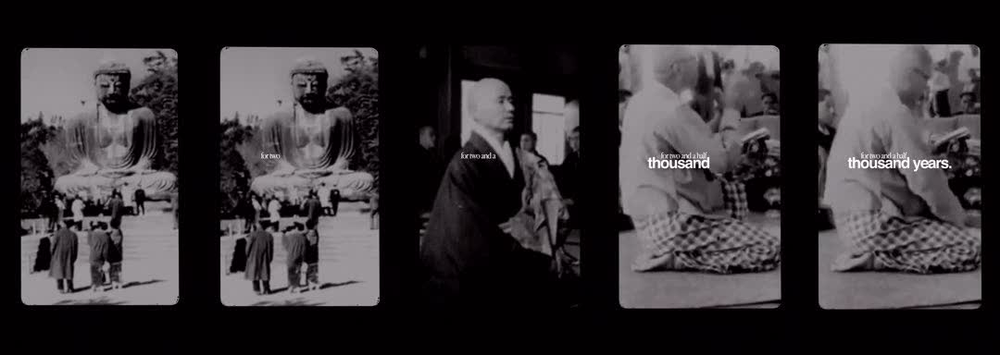

# v10_s28 · 03 Imágenes - personajes + texto · 45.5–47.4s (calidad 4)

- **Guion:** for two and a half thousand years.
- **Qué se ve:** Fondo negro con tarjeta redondeada de archivo B/N: Gran Buda con visitantes; luego monje en meditación; luego hombre arrodillado rezando. 'for two and a half' pequeño, 'thousand years.' grande.
- **Diseño:** 'for two and a half' serif pequeña blanca; 'thousand years.' sans bold blanca. Centro de la tarjeta. Tarjeta ~80% ancho, esquinas redondeadas, centrada.
- **Efectos:** Archivo B/N con grano y desgaste, bordes de película.
- **Animación:** Cortes entre clips de archivo dentro de la misma tarjeta; texto acumulativo por palabra.
- **Por qué aquí:** Antigüedad = archivo B/N; la tarjeta enmarca 'documento histórico'.
