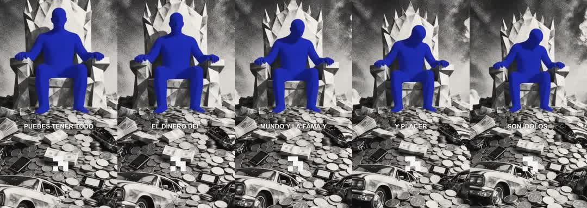

# v18_s01 · 03 Imágenes - personajes + texto · 0.0–6.7s (calidad 5)

- **Guion:** Puedes tener todo el dinero del mundo y la fama y el poder y placer. Son ídolos, si
- **Qué se ve:** Imagen fija generada/ilustrada: figura humana anónima azul sólido sentada en un trono de piedra sobre montañas de monedas, billetes y coches antiguos, todo en B/N excepto la figura. Captions pequeños 'PUEDES TENER TODO', 'MUNDO Y LA FAMA Y', 'EL PODER', 'Y PLACER'. Logo pixel abajo.
- **Diseño:** Figura azul #1A2BE0 plana (sin textura) en el centro-superior; fondo B/N de alto detalle. Caption sans bold MAYÚSCULAS blanca pequeña (~2.5 % altura) a ~60 % altura.
- **Efectos:** B/N granulado con un único color (color selectivo azul), cielo dramático.
- **Animación:** Plano casi estático con push-in muy lento durante 6.7 s; captions palabra a palabra.
- **Por qué aquí:** Hook simbólico: 'ídolos' = trono de riqueza; el azul aísla al 'yo' que lo tiene todo. Imagen insólita que frena el scroll.
