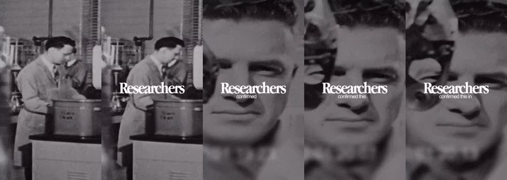

# v19_s10 · 03 Imágenes - personajes + texto · 12.5–13.8s (calidad 4)

- **Guion:** Researchers confirmed this in
- **Qué se ve:** Metraje de archivo B/N de un científico en laboratorio, luego primer plano de un rostro de archivo con glitch/datamosh de bloques; texto 'Researchers' grande + 'confirmed this in' pequeño debajo, centrado.
- **Diseño:** Serif Didone bold blanca grande (~14 % ancho), secundaria sans pequeña. Centro exacto. B/N gris #726E71.
- **Efectos:** Desaturación total, grano de archivo, glitch de macrobloques (datamosh) en la transición.
- **Animación:** 4 cortes rápidos (≈0.2–0.5 s); el glitch actúa como transición entre planos; texto permanece fijo y se completa palabra a palabra.
- **Por qué aquí:** Autoridad: imagen de 'ciencia antigua' para respaldar el dato. El glitch añade energía al pasar de idea a evidencia.
