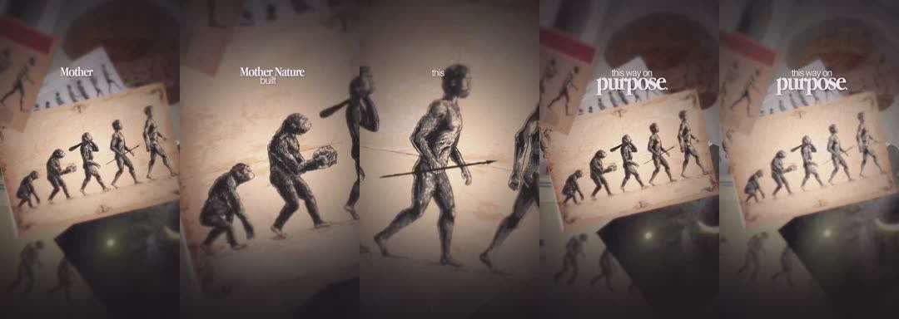

# v19_s19 · 03 Imágenes - personajes + texto · 33.0–35.4s (calidad 4)

- **Guion:** Mother Nature built it this way on purpose.
- **Qué se ve:** Ilustraciones de 'la evolución del hombre' (simios a humano) sobre papel envejecido; tarjetas inclinadas superpuestas; texto 'Mother Nature' + 'built' y luego 'this way on' + 'purpose.'
- **Diseño:** Serif Didone blanca bold, palabra clave grande ('Mother Nature', 'purpose.'), secundaria pequeña. Tercio superior. Sepia #887669 / marrones.
- **Efectos:** Textura de papel antiguo, viñeta oscura, grano; tarjetas con sombra.
- **Animación:** Cámara 2.5D: lenta deriva/zoom sobre las tarjetas inclinadas; segunda tarjeta entra girada (≈0.4 s).
- **Por qué aquí:** 'Mother Nature' → evolución: imagen histórica/científica que hace tangible el 'por diseño'.
