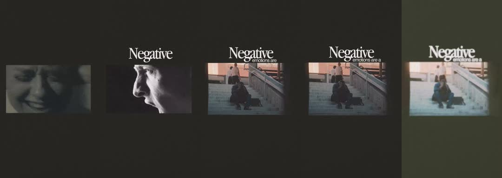

# v19_s20 · 03 Imágenes - personajes + texto · 35.4–36.8s (calidad 3)

- **Guion:** Negative emotions are a survival
- **Qué se ve:** Flash de mujer llorando; luego fondo oliva oscuro con foto enmarcada de una persona sentada sola en escaleras; 'Negative' grande + 'emotions are a' pequeño encima de la foto.
- **Diseño:** Serif Didone blanca, tercio superior; foto rectangular centrada ~70 % ancho. Fondo #272422.
- **Efectos:** Foto con tono frío vintage, grano; fondo plano oscuro.
- **Animación:** Corte + pop de la foto con escala; texto blur-in.
- **Por qué aquí:** 'Negative emotions' → imagen de soledad/tristeza: emoción, no diagrama.
