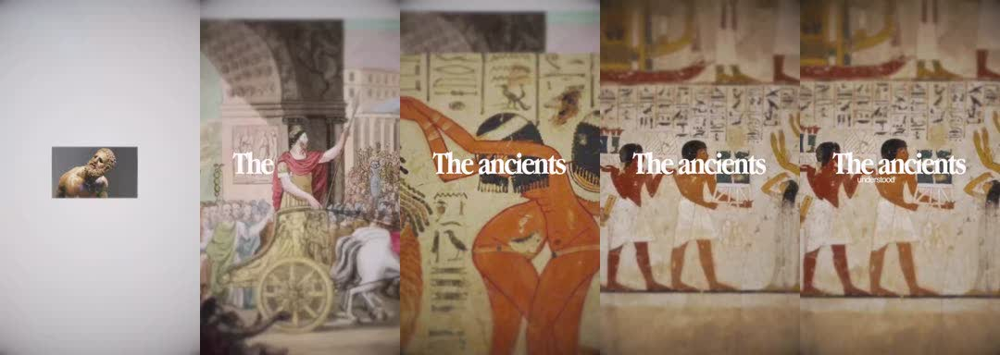

# v19_s23 · 03 Imágenes - personajes + texto · 43.8–44.8s (calidad 5)

- **Guion:** The ancients understood this
- **Qué se ve:** Montaje relámpago de arte antiguo: busto de bronce griego, cabeza de estatua clásica, fresco romano con carro, pintura funeraria egipcia; 'The' y luego 'The ancients' + 'understood' en serif blanca grande sobre ellas.
- **Diseño:** Serif Didone blanca bold, centro; colores tierra #914F28/#A99671.
- **Efectos:** Grano, leve desaturación; las imágenes a sangre.
- **Animación:** Cortes de 3–4 fotogramas (≈0.15 s) a ritmo de staccato; texto fijo mientras las imágenes cambian.
- **Por qué aquí:** 'The ancients' → cascada de antigüedad para dar peso histórico en 1 s; el ritmo rápido despierta atención a mitad de video.
