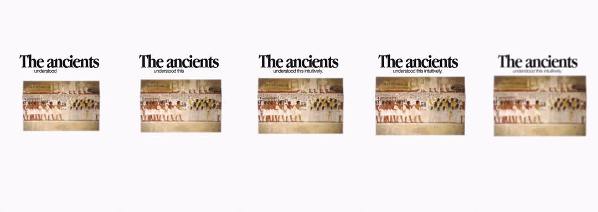

# v19_s24 · 03 Imágenes - personajes + texto · 44.8–46.2s (calidad 4)

- **Guion:** intuitively.
- **Qué se ve:** Fondo blanco; 'The ancients' serif negra grande + 'understood this intuitively.' pequeño en el tercio superior; tarjeta con la pintura egipcia debajo.
- **Diseño:** Serif Didone negra, centrado; tarjeta rectangular ~65 % ancho sin borde con sombra suave.
- **Efectos:** Plano blanco #FAF7FA.
- **Animación:** La imagen se reduce a tarjeta (scale-down desde pantalla completa ≈0.3 s) y el fondo pasa a blanco.
- **Por qué aquí:** Cierra la cascada fijando la idea en un layout limpio y legible.
