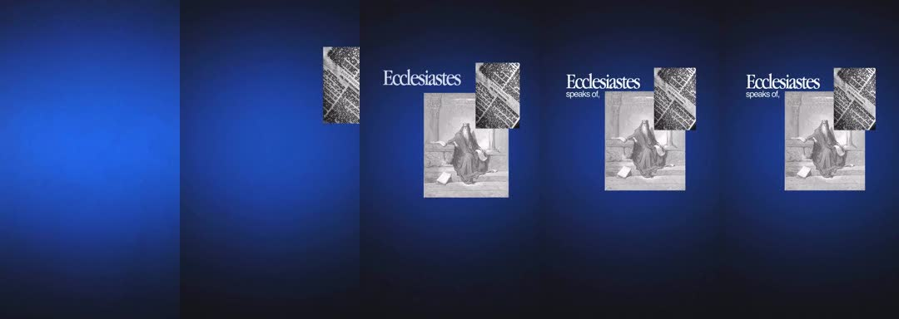

# v19_s25 · 03 Imágenes - personajes + texto · 46.2–47.8s (calidad 4)

- **Guion:** Ecclesiastes speaks of
- **Qué se ve:** Fondo azul marino con gradiente radial; 'Ecclesiastes' serif blanca grande arriba-izquierda + 'speaks'; collage a la derecha: grabado de Doré (profeta) y boceto arquitectónico en tarjetas superpuestas inclinadas.
- **Diseño:** Serif Didone blanca; tarjetas con borde blanco fino. Azul marino #13192C → #162E6D centro.
- **Efectos:** Grabados B/N; gradiente oscuro tipo viñeta.
- **Animación:** Tarjetas entran apiladas con ligero giro (≈0.3 s); drift lento.
- **Por qué aquí:** Cita bíblica → iconografía clásica; da autoridad religiosa/filosófica.
