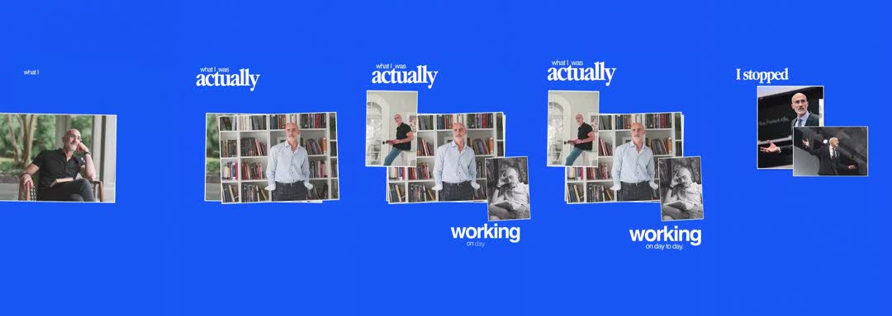

# v19_s35 · 03 Imágenes - personajes + texto · 62.8–66.0s (calidad 4)

- **Guion:** what I was actually working on day to day.
- **Qué se ve:** Fondo azul; 'what I was' + 'actually' serif blanca arriba-izquierda; collage de fotos reales del narrador (Arthur Brooks en su estudio con librerías) en tarjetas con borde blanco superpuestas; 'working' + 'on day to day.' abajo-derecha.
- **Diseño:** Tarjetas blancas con borde ~1.5 %, rotaciones leves; texto en diagonal opuesta (arriba-izq / abajo-der) para equilibrio. Serif Didone + sans pequeña.
- **Efectos:** Sombra suave bajo tarjetas.
- **Animación:** Tarjetas entran apilándose una a una (stagger ≈0.2 s) con pop; texto inferior aparece después.
- **Por qué aquí:** Primera aparición del narrador real: conecta la voz con una persona, credibilidad personal.
