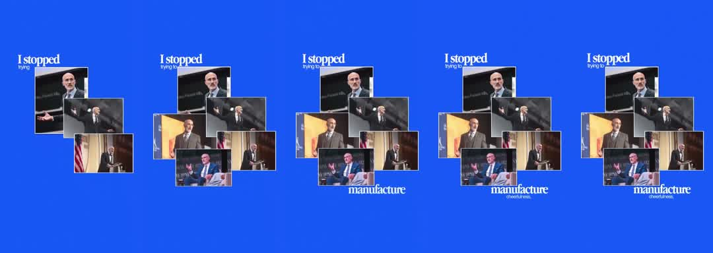

# v19_s36 · 03 Imágenes - personajes + texto · 66.0–68.3s (calidad 4)

- **Guion:** I stopped trying to manufacture cheerfulness and
- **Qué se ve:** Mismo layout azul: 'I stopped' + 'trying to' arriba-izq; collage de fotos del narrador dando conferencias; 'manufacture' + 'cheerfulness.' abajo-derecha.
- **Diseño:** Igual que escena anterior (sistema repetido).
- **Efectos:** Igual.
- **Animación:** Las tarjetas anteriores se sustituyen por nuevas con stagger.
- **Por qué aquí:** Repetición de layout = continuidad de idea; las conferencias = 'fabricar alegría' en público.
