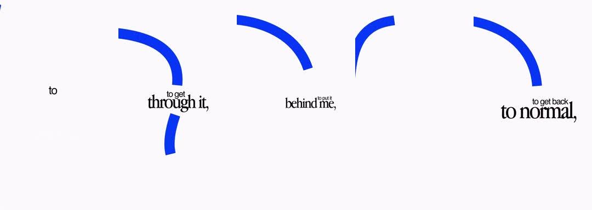

# v10_s11 · 04 Línea + texto · 14.1–17.7s (calidad 5)

- **Guion:** to get through it, to put it behind me, to get back to normal,
- **Qué se ve:** Fondo blanco; un arco azul grueso (segmento de anillo) gira alrededor del encuadre como una rueda/rotonda, aparece y desaparece por los bordes. El texto cambia por cláusula: 'to', 'to get / through it,', 'to put it / behind me,', 'to get back / to normal,' y se desplaza de posición (centro → derecha).
- **Diseño:** Frase clave en serif condensada negra grande (through it / behind me / to normal), prefijo en sans pequeña negra como super-índice ('to get', 'to put it', 'to get back'). Arco azul sólido #0B3FF5 de grosor ~4% del ancho, sin bordes redondeados. Texto alrededor de la mitad vertical, alternando centro y lado derecho.
- **Efectos:** Plano y limpio, sin textura apreciable.
- **Animación:** El arco rota continuamente (~90°/s) y se recorta, incluso parte en dos segmentos por un instante; cada cláusula reemplaza a la anterior con corte de texto (no fade largo) cada ~1.1 s, sincronizada a la voz. Sensación de bucle/rueda de hámster.
- **Por qué aquí:** Lista de tres intentos de 'volver a la normalidad': el arco que gira sin cerrar el círculo visualiza el ciclo repetitivo que no lleva a ninguna parte.
