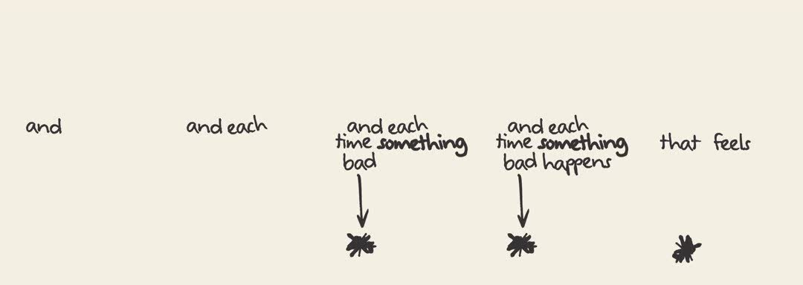

# v04_s05 · 05 Línea + ilustraciones · 8.0–10.5s (calidad 5)

- **Guion:** And each time something bad happens that feels
- **Qué se ve:** Crema: 'and each / time something / bad happens' con una flecha manuscrita hacia abajo que apunta a una mancha de tinta negra tipo bicho/salpicadura.
- **Diseño:** Texto ~40 % alto centrado; flecha de trazo a mano; mancha negra ~10 % ancho a ~85 % alto.
- **Efectos:** Mancha con bordes de tinta irregular (splat).
- **Animación:** La flecha se dibuja de arriba abajo (≈0.3 s) y la mancha aparece con pop.
- **Por qué aquí:** Visualiza 'algo malo' como un borrón: lo abstracto se vuelve objeto.
