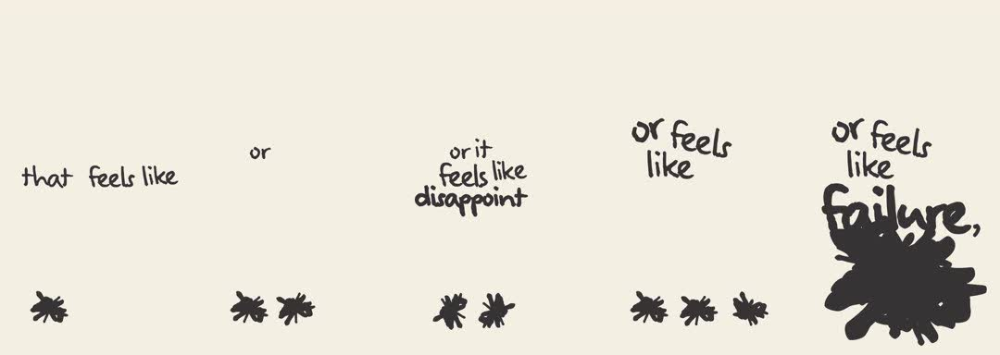

# v04_s06 · 05 Línea + ilustraciones · 10.5–13.6s (calidad 5)

- **Guion:** like a loss or it feels like a disappointment or feels like a failure,
- **Qué se ve:** 'that feels like / a loss' con flecha a una segunda mancha (2 manchas), luego 'or feels' con 3 manchas abajo.
- **Diseño:** Texto en el tercio superior; manchas alineadas en la franja inferior (~85 % alto), se acumulan 1 → 2 → 3.
- **Efectos:** Manchas de tinta.
- **Animación:** Cada nuevo 'feels like' añade una mancha con pop (≈0.15 s).
- **Por qué aquí:** Acumulación visual = las cosas malas se van sumando (conteo).
