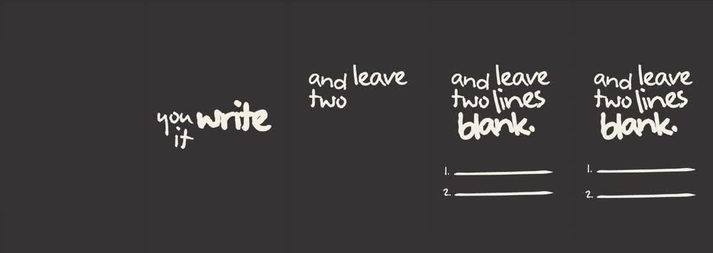

# v04_s07 · 05 Línea + ilustraciones · 13.6–16.0s (calidad 5)

- **Guion:** you write it down and leave two lines blank.
- **Qué se ve:** Cambio a fondo gris oscuro: 'you write it' y luego 'and leave / two lines / blank.' con dos líneas numeradas '1.' y '2.' dibujadas debajo.
- **Diseño:** Fondo carbón ~#353535; texto crema ~#F3EEE3 manuscrito, 'write' y 'blank.' bold grandes. Líneas blancas a mano a ~83 % y ~88 % alto con números pequeños a la izquierda.
- **Efectos:** Inversión de color (negativo) para marcar la fase 'instrucciones'.
- **Animación:** Corte seco a negro; texto write-on; las líneas se dibujan de izquierda a derecha (≈0.3 s cada una).
- **Por qué aquí:** Paso práctico: el cambio a oscuro separa la explicación del método; las líneas son literalmente lo que hay que hacer.
