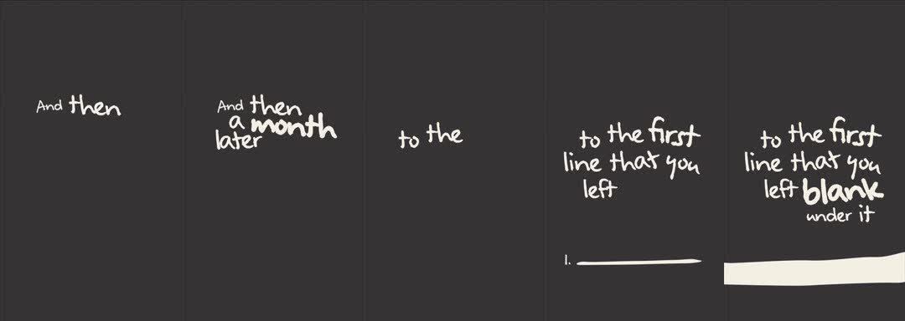

# v04_s09 · 05 Línea + ilustraciones · 20.5–24.2s (calidad 4)

- **Guion:** then a month later, you come back to the first line that you left blank under it
- **Qué se ve:** Oscuro: 'And then / a month / later you' y luego 'to the first / line that you / left' con la línea '1.' dibujada abajo.
- **Diseño:** 'month' bold; línea '1.' a ~83 % alto.
- **Efectos:** Fondo oscuro.
- **Animación:** Write-on; la línea reaparece dibujándose.
- **Por qué aquí:** Refuerza la mecánica del método con el mismo elemento gráfico (línea 1).
