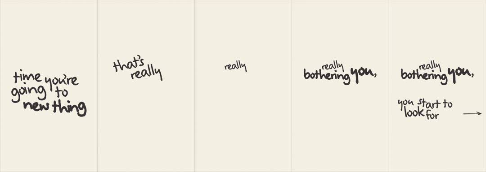

# v04_s14 · 05 Línea + ilustraciones · 35.0–39.5s (calidad 4)

- **Guion:** thing that's really bugging you, really bothering you, you start to look forward
- **Qué se ve:** Crema: 'that's / really / bugging / you,' (inclinado), luego 'really bothering you,' arriba y 'you start to / look forward / to' con una flecha manuscrita hacia la derecha.
- **Diseño:** 'bugging' bold grande con rotación ~-5°; 'you,' desplazado abajo-derecha; flecha horizontal fina a ~65 % alto.
- **Efectos:** Ninguno.
- **Animación:** Build-up; la flecha se dibuja hacia la derecha (≈0.3 s) = 'hacia adelante'.
- **Por qué aquí:** Representa literal 'mirar hacia adelante' con una flecha.
