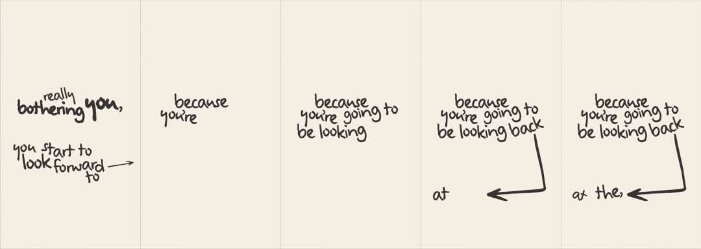

# v04_s15 · 05 Línea + ilustraciones · 39.5–42.5s (calidad 5)

- **Guion:** to it because you're going to be looking back at the
- **Qué se ve:** Crema: 'because / you're going to / be looking back' con una flecha en L que baja y vuelve hacia la izquierda; luego 'at the'.
- **Diseño:** Texto en el tercio superior; flecha en ángulo recto (baja ~20 % y gira a la izquierda) a ~75 % alto.
- **Efectos:** Ninguno.
- **Animación:** La flecha se dibuja (≈0.4 s) hacia atrás.
- **Por qué aquí:** Opuesto visual de la escena anterior: 'mirar atrás' = flecha que regresa.
