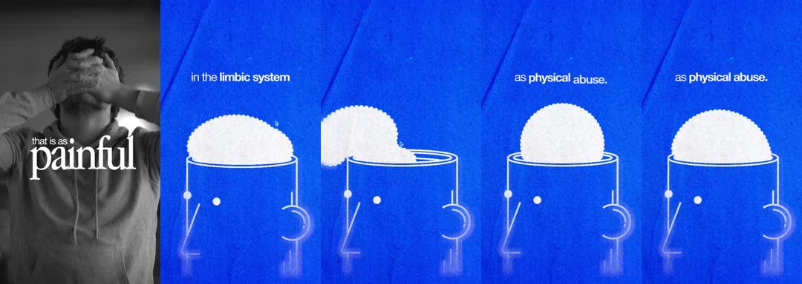

# v08_s09 · 05 Línea + ilustraciones · 13.0–16.3s (calidad 5)

- **Guion:** in the limbic system of the brain as physical abuse.
- **Qué se ve:** Fondo azul con textura de papel; ilustración de líneas blancas finas de una cabeza de perfil esquemática (rasgos como puntos y líneas, cabeza abierta como un recipiente) de la que sale un cerebro blanco esponjoso/nube; el cerebro sube y baja.
- **Diseño:** 'in the limbic system' sans blanca pequeña con 'limbic system' bold; luego 'as physical abuse.' con 'physical abuse.' bold. Tercio superior. Líneas blancas 2 px con glow suave.
- **Efectos:** Textura de papel, glow en las líneas, cerebro con textura de puntos.
- **Animación:** El cerebro emerge de la cabeza (sube) y se vuelve a hundir; la tapa/anillo se dibuja; texto write-on con palabra en gris que se aclara.
- **Por qué aquí:** Explicación neurológica: diagrama simple y amable en vez de imagen médica realista para que el dato se entienda.
