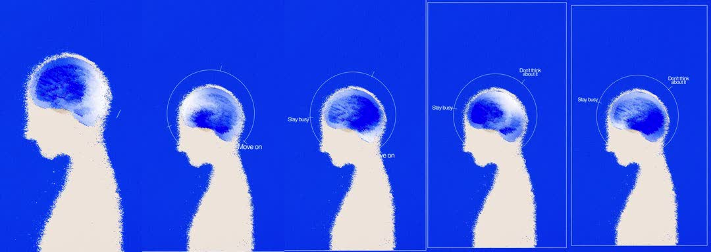

# v10_s06 · 05 Línea + ilustraciones · 5.9–8.6s (calidad 5)

- **Guion:** Move on, stay busy, don't think about it,
- **Qué se ve:** Fondo azul. Perfil de cabeza humana en color crema que mira hacia abajo, con el cerebro pintado en azules acuarela. Un círculo fino blanco orbita la cabeza con pequeñas marcas (ticks); tres etiquetas conectadas con líneas guía finas: 'Move on', 'Stay busy', 'Don't think about it'. Aparece un marco rectangular fino blanco (inset) alrededor de toda la imagen.
- **Diseño:** Etiquetas en sans regular blanca muy pequeña (Helvetica/Inter), con líneas guía de 1 px blancas. Cabeza centrada, ocupa 2/3 inferiores. Azul fondo ~#0A3BF5, crema #EDE6DC, cerebro azul #1B3FE0 con blancos. Marco inset de 1 px a ~3% del borde.
- **Efectos:** Bordes de la cabeza granulados/dispersos (efecto partículas), cerebro con textura acuarela/halftone. Textura de papel sutil en el azul.
- **Animación:** La cabeza entra con zoom-out desde un encuadre cerrado (~0.6 s, ease-out); el círculo orbital se dibuja (stroke draw-on) y rota lentamente; las etiquetas aparecen secuenciales sincronizadas con cada frase, cada una con su línea guía que se traza; al final aparece el marco inset (fade). Suave, tipo infografía.
- **Por qué aquí:** Lista de tres consejos 'sanos' que en realidad son evasión: se visualizan como pensamientos orbitando la cabeza (ruido mental). Animación = momento de valor que se enumera.
