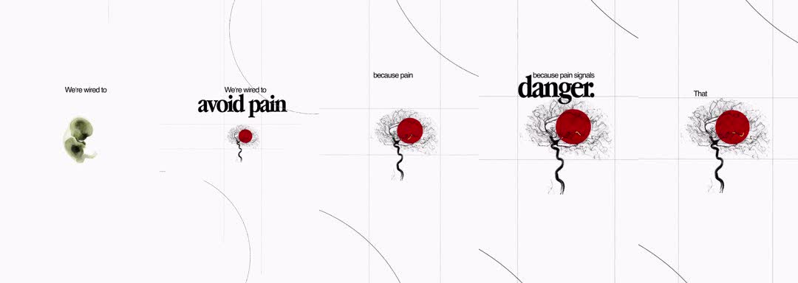

# v10_s18 · 05 Línea + ilustraciones · 28.0–31.0s (calidad 5)

- **Guion:** to avoid pain because pain signals danger.
- **Qué se ve:** Fondo blanco con retícula técnica (líneas finas verticales/horizontales grises) y grandes arcos circulares de 1 px. Primero un pequeño embrión verdoso con 'We're wired to'; luego dibujo de tinta de un cerebro/red vascular (tipo grabado Cajal/angiograma) con un sol rojo sólido detrás; crece con zoom. Texto 'because pain signals' + 'danger.'
- **Diseño:** 'danger.' serif negra ultra-condensada y pesada (tipo Playfair Black compacta) grande con punto; 'because pain signals' sans pequeña negra encima. Bloque en el tercio superior centrado; ilustración bajo el texto. Rojo #C8161D, tinta negra, grid gris #CFCFD4.
- **Efectos:** Textura de grabado/tinta, papel limpio; estética de lámina científica.
- **Animación:** Push-in de cámara continuo sobre la ilustración (del 30% al 100% de tamaño en ~1.5 s); los arcos del grid se desplazan en parallax; texto write-on por palabra con 'danger.' en pop.
- **Por qué aquí:** Explicación biológica: estética de lámina médica + rojo = alarma/peligro. El zoom simula acercarse al cerebro que procesa la señal.
