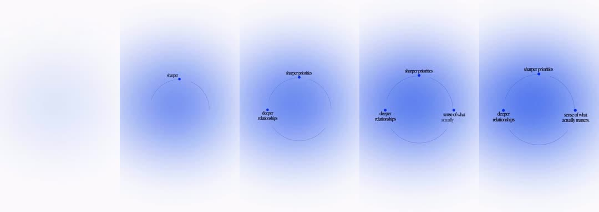

# v10_s37 · 05 Línea + ilustraciones · 62.4–68.2s (calidad 5)

- **Guion:** Sharper priorities, deeper relationships, a clearer sense of what actually matters.
- **Qué se ve:** Fondo blanco con una gran mancha radial azul difuminada en el centro; un círculo fino azul con tres puntos que aparecen en secuencia, cada uno con etiqueta: 'sharper priorities' (arriba), 'deeper relationships' (izquierda), 'sense of what actually matters.' (derecha).
- **Diseño:** Etiquetas serif pequeña negra (2 líneas cuando hace falta) junto a cada punto azul sólido. Círculo 1 px azul. Glow radial #3A62F0 → blanco ocupando 80% del frame. Centrado.
- **Efectos:** Gradiente radial muy suave (blur grande), limpio.
- **Animación:** Arranca en blanco; el glow azul aparece con fade+expansión (~0.5 s); el círculo se dibuja en arcos y cada punto + etiqueta aparece sincronizado con cada beneficio (write-on por palabra); 'actually' entra gris. Ritmo lento ~1.8 s por ítem.
- **Por qué aquí:** Lista de tres beneficios = momento de valor: se ordenan en un ciclo/sistema, sensación de calma y claridad (glow suave).
