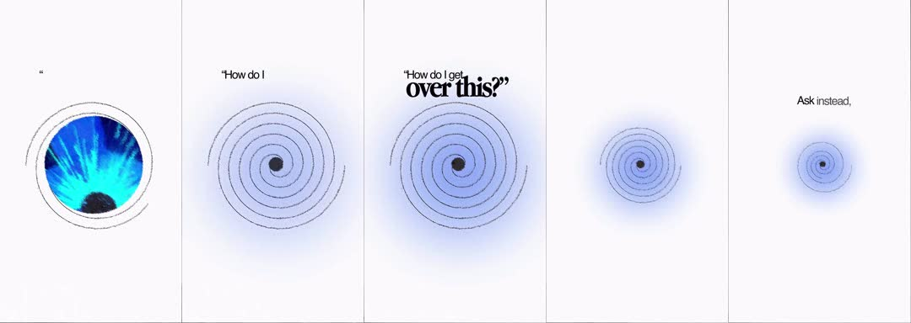

# v10_s40 · 05 Línea + ilustraciones · 72.3–74.5s (calidad 5)

- **Guion:** how do I get over this?
- **Qué se ve:** Fondo blanco; el círculo con la figura se reduce y unas líneas en espiral dibujadas a mano lo rodean; aparece una comilla de apertura sola, luego '“How' y '“How do I get / over this?”'; la imagen interior desaparece y queda un punto negro en el centro de la espiral con glow azul.
- **Diseño:** 'over this?”' serif negra condensada grande con comillas tipográficas curvas; '“How do I get' sans pequeña negra. Tercio superior-izquierdo. Espiral de trazo gris oscuro 1–2 px estilo lápiz; glow radial azul claro.
- **Efectos:** Trazos irregulares de lápiz, glow suave.
- **Animación:** La espiral se dibuja (draw-on) enroscándose alrededor del círculo mientras éste se encoge hasta ser un punto (~1 s); comillas aparecen antes que las palabras (la cita 'se abre'); write-on por palabra.
- **Por qué aquí:** La pregunta equivocada es un bucle: la espiral que se cierra sobre sí misma = rumiar. Las comillas marcan que es una pregunta textual.
