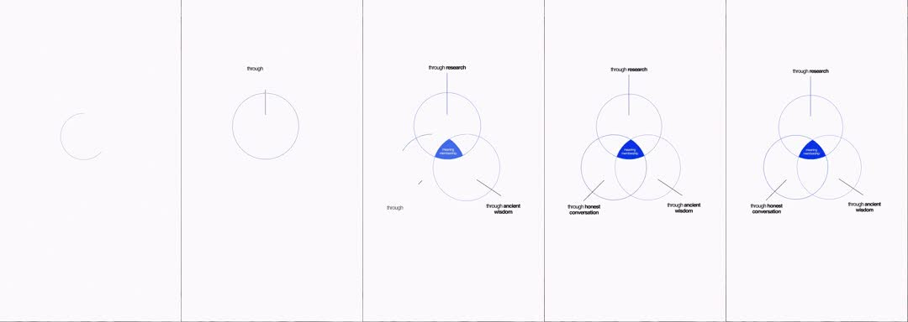

# v10_s50 · 05 Línea + ilustraciones · 90.6–94.6s (calidad 5)

- **Guion:** through research, through ancient wisdom, and through honest conversation.
- **Qué se ve:** Fondo blanco; diagrama de Venn de tres círculos finos azul-grisáceos que se dibujan uno a uno, cada uno con línea guía hacia su etiqueta: 'through research' (arriba), 'through ancient wisdom' (abajo-derecha), 'through honest conversation' (abajo-izquierda). La intersección central se rellena de azul con texto diminuto 'meaning membership'.
- **Diseño:** Etiquetas sans pequeña negra con la palabra clave en bold ('research', 'ancient wisdom', 'honest conversation'). Círculos 1 px #8FA0C8; intersección azul sólido #0B3FF5 con texto blanco diminuto. Centrado, ~55% del ancho.
- **Efectos:** Plano, sin textura.
- **Animación:** Cada círculo se dibuja con stroke draw-on (~0.4 s) sincronizado con su frase; las líneas guía se trazan hacia la etiqueta; la intersección se rellena con pop al completar el tercero. Ligero reposicionamiento/zoom para centrar al final.
- **Por qué aquí:** Tres pilares = Venn: comunica que la membresía es la intersección de los tres. Visualizar una lista de valor.
