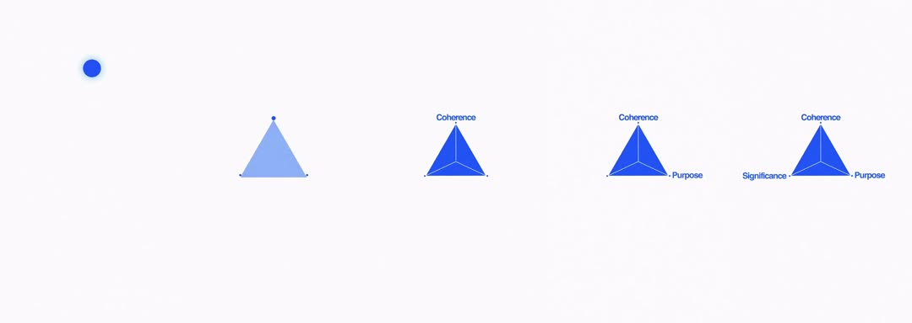

# v12_s20 · 05 Línea + ilustraciones · 31.6–36.2s (calidad 5)

- **Guion:** meaning has three parts. Coherence, purpose, and significance.
- **Qué se ve:** Un punto azul aparece en el centro; se expande en un triángulo equilátero azul con un punto en cada vértice; al nombrar cada parte aparece su etiqueta en el vértice ('Coherence' arriba, 'Purpose' abajo-derecha, 'Significance' abajo-izquierda) y el triángulo se divide en 3 facetas con líneas blancas desde el centro (efecto pirámide 3D).
- **Diseño:** Triángulo #568BF6→#1954F7 ~25 % del ancho centrado a ~50 %; puntos de vértice azul oscuro; etiquetas sans bold azul pequeña junto a cada vértice. Fondo #FAF7FB.
- **Efectos:** Grano de papel; sin sombras.
- **Animación:** Punto → triángulo crece desde el centro (scale con ease-out ~0.4 s); etiquetas entran con fade sincronizadas a cada palabra (33.2, 34.0, 35.2 s); las líneas internas se dibujan (line draw ~0.3 s). Preciso y limpio.
- **Por qué aquí:** Momento de valor/framework: 3 partes = diagrama de 3 vértices. Visualizar el modelo lo hace memorizable.
