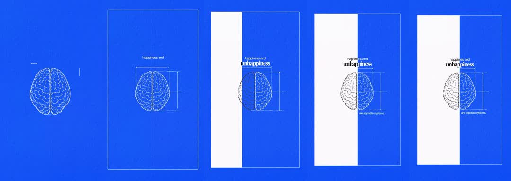

# v19_s09 · 05 Línea + ilustraciones · 9.5–12.5s (calidad 5)

- **Guion:** happiness and unhappiness are separate systems.
- **Qué se ve:** Cerebro dibujado en línea blanca (vista superior) sobre azul; luego la pantalla se divide: panel blanco a la izquierda y azul a la derecha con marco de línea fina, el cerebro queda partido en dos mitades con cotas/medidas tipo plano técnico. Texto 'happiness and' pequeño + 'unhappiness' serif.
- **Diseño:** Line art blanco/negro 1 px, estética blueprint; azul #0C54F9 y blanco #FAF8FB. Texto en el centro sobre el cerebro, serif Didone + sans diminuta. Marco rectangular fino con margen ~8 %.
- **Efectos:** Plano, sin grano; líneas de acotación (estilo dibujo técnico).
- **Animación:** El cerebro se dibuja (stroke draw-on ≈0.6 s); después un panel blanco desliza desde la izquierda tapando la mitad (wipe ≈0.4 s) para mostrar 'dos sistemas'.
- **Por qué aquí:** Momento de valor conceptual ('separate systems'): se visualiza literalmente partiendo el cerebro en dos. Animación > b-roll cuando hay una idea que explicar.
