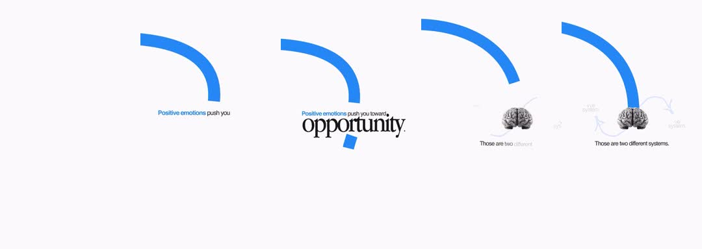

# v19_s22 · 05 Línea + ilustraciones · 39.8–43.8s (calidad 5)

- **Guion:** Positive emotions push you toward opportunity. Those are two different systems.
- **Qué se ve:** Fondo blanco; un arco azul grueso entra desde la esquina superior izquierda y gira como aguja de dial; 'Positive emotions' en azul sans + 'push you toward' + 'opportunity' serif negra grande. Luego cerebro 3D gris pequeño a la derecha y 'Those are two' diminuto.
- **Diseño:** Arco azul #1781F9 trazo grueso (~5 % ancho) con extremos rectos; 'opportunity' serif Didone ~80 % ancho, centro vertical. Palabra 'Positive emotions' en azul acento.
- **Efectos:** Plano; cerebro con render fotográfico sin fondo.
- **Animación:** Arco barre en rotación (≈0.6 s, ease in-out) como un dial que gira; texto pop; el arco sigue rotando al plano siguiente (continuidad).
- **Por qué aquí:** El arco = el dial que gira hacia la oportunidad. Acento azul en la palabra 'Positive' para codificar color = positivo.
