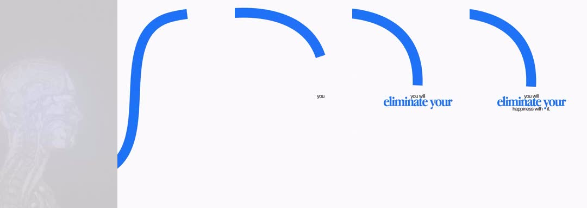

# v19_s46 · 05 Línea + ilustraciones · 89.3–91.4s (calidad 4)

- **Guion:** your happiness with it. So
- **Qué se ve:** Fondo blanco; el arco azul grueso vuelve, girando desde arriba; 'you will' pequeño + 'eliminate' serif azul.
- **Diseño:** Arco azul #116DFB; serif Didone azul; centro-derecha.
- **Efectos:** Plano.
- **Animación:** Arco rota como aguja de dial (≈0.6 s); texto pop.
- **Por qué aquí:** Callback del dial de la escena 22: el mismo objeto ahora apunta al resultado negativo.
