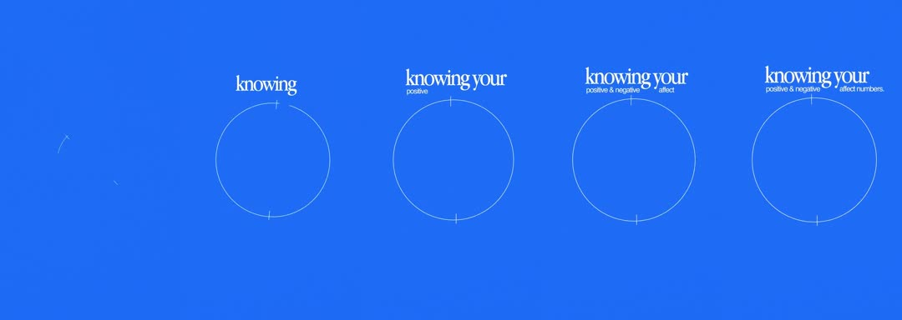

# v19_s47 · 05 Línea + ilustraciones · 91.4–95.0s (calidad 4)

- **Guion:** the first step is knowing your positive and negative affect numbers.
- **Qué se ve:** Azul; un círculo blanco fino con ticks se dibuja en el centro; 'knowing your' serif + 'positive & negative' pequeño arriba.
- **Diseño:** Círculo línea 1 px blanco ~55 % ancho, centrado; serif Didone blanca tercio superior.
- **Efectos:** Plano.
- **Animación:** Círculo draw-on (≈0.6 s) y gira lento; texto write-on.
- **Por qué aquí:** Paso práctico → dial vacío que el espectador debe 'medir'. Prepara el CTA del test.
