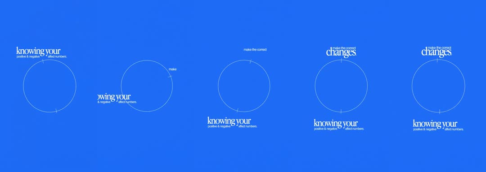

# v19_s49 · 05 Línea + ilustraciones · 98.0–100.8s (calidad 3)

- **Guion:** working with, and to make the correct changes.
- **Qué se ve:** Azul; círculo fino con ticks; 'make the correct' diminuto arriba-derecha; 'knowing your' + 'positive & negative affect numbers.' abajo-izquierda.
- **Diseño:** Igual sistema; texto ahora en la parte inferior (variación de posición).
- **Efectos:** Plano.
- **Animación:** Círculo gira; texto se recoloca con slide.
- **Por qué aquí:** Repite el sistema visual para cerrar la sección de 'pasos'.
