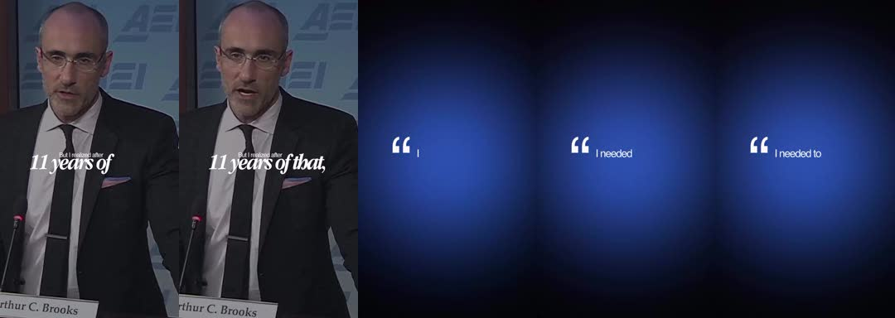

# v01_s42 · 06 Escenas solo texto · 84.0–85.3s (calidad 5)

- **Guion:** years of that that I needed to change.
- **Qué se ve:** Fondo de gradiente radial azul con comilla serif grande '“' y texto 'I' empezando a escribirse.
- **Diseño:** Gradiente radial azul eléctrico ~#1E3AA8 en el centro a negro #05060F en bordes; comilla serif blanca grande (~6 % alto) a la izquierda del centro; texto serif/sans pequeño a su lado.
- **Efectos:** Glow/viñeta radial, sin textura.
- **Animación:** Fade-in del gradiente, comilla pop, texto write-on por palabra (≈1 s).
- **Por qué aquí:** Pensamiento interior (cita a sí mismo): el azul cambia el registro a introspección.
