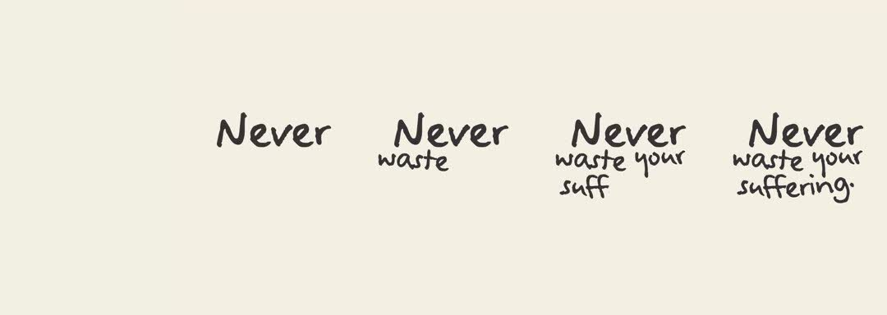

# v04_s01 · 06 Escenas solo texto · 0.0–1.2s (calidad 4)

- **Guion:** Never waste your suffering.
- **Qué se ve:** Papel crema liso con 'Never / waste' manuscrito.
- **Diseño:** Letra manuscrita de marcador (tipo rotulador redondo, ligeramente irregular) gris carbón ~#2B2B2B. 'Never' grande (~7 % alto) bold, 'waste' más pequeña debajo-izquierda. Bloque a ~40–48 % alto, alineado a la izquierda del centro. Fondo crema ~#F3EEE3.
- **Efectos:** Fondo liso, sin grano; trazo con bordes levemente rugosos (tinta).
- **Animación:** Write-on por palabra sincronizado con la voz (≈0.2–0.3 s por palabra), aparición seca tipo 'pop' sin rebote.
- **Por qué aquí:** Hook: la frase-tesis completa en el segundo 0, tipografía manuscrita = tono íntimo de cuaderno.
