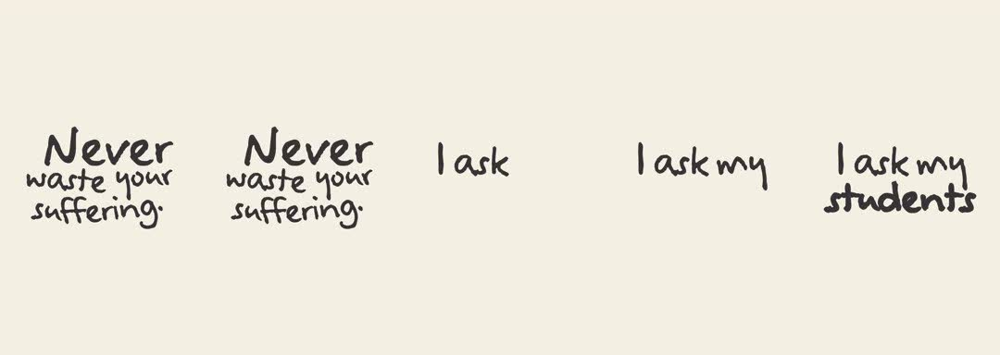

# v04_s02 · 06 Escenas solo texto · 1.2–2.4s (calidad 3)

- **Guion:** I ask my students
- **Qué se ve:** Crema: 'I ask my / students'.
- **Diseño:** 'I ask my' manuscrita fina; 'students' bold grande debajo. Centro ~45 % alto.
- **Efectos:** Ninguno.
- **Animación:** La tarjeta anterior desaparece en corte seco; write-on por palabra.
- **Por qué aquí:** Contexto de autoridad (profesor) con mínima carga visual.
