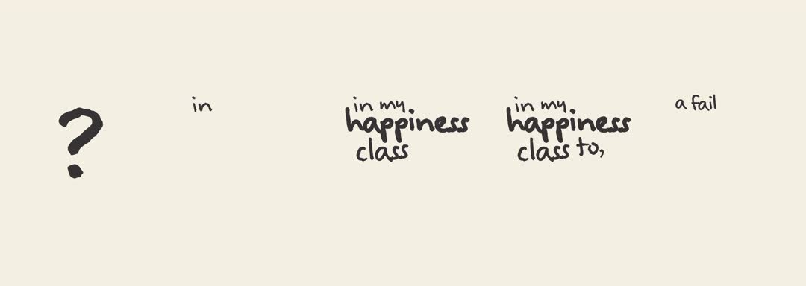

# v04_s03 · 06 Escenas solo texto · 2.4–5.5s (calidad 3)

- **Guion:** in my happiness class to keep a
- **Qué se ve:** Crema: 'in my / happiness' y luego se apila 'class to, / keep'.
- **Diseño:** 'in my' pequeña arriba-izquierda, 'happiness' bold grande, 'class to,' y 'keep' debajo con ligeras rotaciones (±3°). Bloque crece hacia abajo desde ~35 %.
- **Efectos:** Ninguno.
- **Animación:** Palabras se añaden debajo (build-up) por palabra.
- **Por qué aquí:** La palabra marca ('happiness') en bold; el texto acumulado mantiene el hilo.
