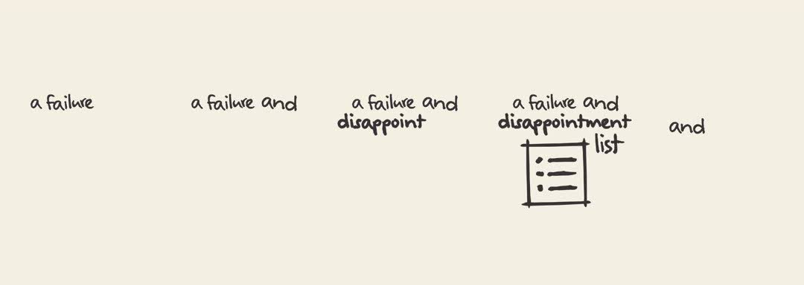

# v04_s04 · 06 Escenas solo texto · 5.5–8.0s (calidad 3)

- **Guion:** failure and disappointment list.
- **Qué se ve:** Crema: 'a failure and / disappoint(ment)' en el tercio superior; luego 'and' sola.
- **Diseño:** Manuscrita mediana; 'disappoint' bold. Posición ~35–40 % alto.
- **Efectos:** Ninguno.
- **Animación:** Write-on por palabra; corte seco a la siguiente frase.
- **Por qué aquí:** Nombra la herramienta (la lista).
