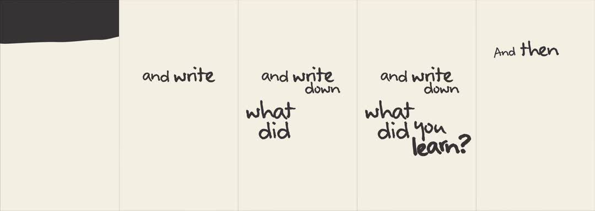

# v04_s10 · 06 Escenas solo texto · 24.2–26.5s (calidad 4)

- **Guion:** and write down what did you learn? And then
- **Qué se ve:** Transición: el papel crema sube desde abajo con borde ondulado irregular tapando el gris; 'and write'.
- **Diseño:** Borde de la ola de crema irregular tipo papel; texto 'and write' a ~45 % alto.
- **Efectos:** Wipe orgánico (borde ondulado).
- **Animación:** Wipe vertical de abajo arriba (≈0.15–0.3 s), rápido y suave.
- **Por qué aquí:** Cambio de fase (del dolor al aprendizaje) marcado con el regreso al color claro.
